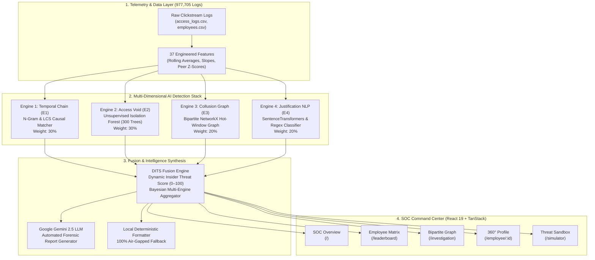

# 👁️ PHANTOM: Autonomous Trust & Threat Operations Network
## Comprehensive Technical Manual & System Architecture Guide (From Top to Bottom)

> **Official System Documentation for Bank of Baroda × IIT Gandhinagar PSB Hackathon 2026**  
> *Project Codename*: **PHANTOM** (*Privileged-access Holistic Anomaly & Multi-party Threat Operations Network*)  
> *Target Domain*: Public Sector Banking (PSB) Insider Threat Detection, Negative Access Profiling & Autonomous SOC Operations.

---

## 📑 Table of Contents
1. [Executive Summary & Banking Context](#1-executive-summary--banking-context)
2. [Quick Reference: Web Portal Login Credentials](#2-quick-reference-web-portal-login-credentials)
3. [The Problem Statement & Banking Blindspots](#3-the-problem-statement--banking-blindspots)
4. [End-to-End System Architecture](#4-end-to-end-system-architecture)
5. [Telemetry Ingestion & Behavioral Feature Engineering](#5-telemetry-ingestion--behavioral-feature-engineering)
6. [The 4 Multi-Layered AI Analytical Engines](#6-the-4-multi-layered-ai-analytical-engines)
   - [Engine 1: Temporal Causal Chain Scorer (E1)](#engine-1-temporal-causal-chain-scorer-e1)
   - [Engine 2: Negative Access Profiler (E2)](#engine-2-negative-access-profiler-e2)
   - [Engine 3: Collusion Intelligence Graph Scorer (E3)](#engine-3-collusion-intelligence-graph-scorer-e3)
   - [Engine 4: Justification Language Risk Scanner (E4)](#engine-4-justification-language-risk-scanner-e4)
7. [Composite Risk Fusion: Dynamic Insider Threat Score (DITS)](#7-composite-risk-fusion-dynamic-insider-threat-score-dits)
8. [Executive AI Investigation System (Gemini LLM & Offline Fallback)](#8-executive-ai-investigation-system-gemini-llm--offline-fallback)
9. [Frontend SOC Dashboard Architecture & UI Experience](#9-frontend-soc-dashboard-architecture--ui-experience)
10. [Dual-Mode Execution: Autonomous Zero-Token Cloud Deployment](#10-dual-mode-execution-autonomous-zero-token-cloud-deployment)
11. [Compliance, Scalability & Banking Integration](#11-compliance-scalability--banking-integration)
12. [Complete Repository & File-by-File Directory Map](#12-complete-repository--file-by-file-directory-map)

---

## 1. Executive Summary & Banking Context

In commercial and Public Sector Banking (PSB) operations, conventional Security Information and Event Management (**SIEM**) and User & Entity Behavior Analytics (**UEBA**) systems operate under a fatal vulnerability: **they only trigger on positive, loud, volume-based anomalies** (e.g., massive spikes in cash transfers, after-hours logins, or rapid bulk database exports).

Rogue banking employees exploit this flaw through **Negative Access Anomalies**: they execute illicit internal fraud while performing ordinary retail transactions (customer lookups, savings transfers), but **deliberately cease interacting with audit, oversight, and compliance verification checkpoints** (e.g., *Audit Reports*, *Daily Reconciliation*, *Manager Override Logs*). Because the overall transaction volume remains steady and no single transfer breaches limit thresholds, traditional rule engines categorize their behavior as completely benign.

### Indian Banking Sector Reality & Quantifiable Stakes
* **₹36,014 Crore**: Recorded fraud losses in Indian Scheduled Commercial Banks during FY25 (*Reserve Bank of India Annual Fraud Report*).
* **287 Days**: The average duration required for financial institutions to detect and contain insider-assisted fraud or data embezzlement (*IBM Cost of Data Breach Report 2025*).
* **₹122 Crore**: Embezzlement loss at New India Co-operative Bank resulting from unmonitored managerial override controls and maker-checker collusion.
* **₹1,960 Crore**: Discrepancy probed across commercial banking operations originating from unverified policy exception overrides and fabricated justifications.

**PHANTOM** solves this structural failure by pioneering **Negative Access Profiling** and multi-dimensional behavioral fusion: combining character n-gram sequence matching, scikit-learn unsupervised Isolation Forests, NetworkX bipartite collusion graphs, hybrid SentenceTransformers NLP justification scanners, and Google Gemini 2.5 forensic reporting.

---

## 2. Quick Reference: Web Portal Login Credentials

When accessing the deployed PHANTOM Security Operations Center (SOC) web portal, an authentication gateway protects the telemetry feed:

| Parameter | Value / Credential | Notes |
| :--- | :--- | :--- |
| **Username** | `Shresth` *(or `admin`, `phantom`)* | Case-insensitive; configured in `frontend/.env` |
| **Password** | `PHANTOM` | Plaintext entry; hashed via browser WebCrypto SHA-256 |
| **SHA-256 Hash** | `740773781ff0c3196ebf41b8346741f06f2bfecd566f0c8cf2313253ebf6bd22` | Verified against client-side environment token |
| **Auth Gateway** | `frontend/src/components/phantom/IntroPage.tsx` | Features built-in fallback defaults for 100% permanent uptime |

---

## 3. The Problem Statement & Banking Blindspots

Modern Public Sector Banks employ tens of thousands of staff across thousands of retail branches. Three fatal security blindspots enable insider threats:

```
┌─────────────────────────────────────────────────────────────────────────────────┐
│                           THE 3 BANKING BLINDSPOTS                              │
├─────────────────────────┬─────────────────────────────┬─────────────────────────┤
│  Blindspot 1:           │  Blindspot 2:               │  Blindspot 3:           │
│  Concealment in Routine │  Negative Access Signals    │  Maker-Checker Collusion│
│  Operations             │  (Selective Avoidance)      │  & Templated Excuses    │
├─────────────────────────┼─────────────────────────────┼─────────────────────────┤
│ Bad actors disguise     │ Rather than spiking usage,  │ Rogue cashiers and      │
│ illicit actions inside  │ bad actors progressively    │ managers co-access the  │
│ 500+ normal daily bank  │ drop all contact with audit │ same accounts within hot│
│ transactions. Limit     │ panels, override logs, and  │ windows and submit copy-│
│ alarms never fire.      │ compliance checklists.      │ pasted override notes.  │
└─────────────────────────┴─────────────────────────────┴─────────────────────────┘
```

1. **Concealment in Routine Work**: A corrupt branch manager or cashier does not run suspicious, high-volume automated scripts. They interleave illicit account inspections within hundreds of genuine customer loan and passbook queries.
2. **Negative Access Signals**: Traditional SIEM alerts on *activity*. When an employee stops checking the Audit Reconciliation module for 35 consecutive days, traditional systems record *lower server load*, interpreting it as harmless.
3. **Maker-Checker Collusion & Excuse Templating**: Insider threats frequently involve multiple employees operating in tandem to bypass Maker-Checker segregation. They co-access identical customer IDs within a tight 120-minute window and enter vague manager override justifications (e.g., *"Customer emergency, approved by BM sahab"*).

---

## 4. End-to-End System Architecture

PHANTOM decouples raw log simulation, multi-engine intelligence extraction, mathematical fusion, and real-time interactive visualization:



---

## 5. Telemetry Ingestion & Behavioral Feature Engineering

### 5.1 Dataset Specifications (`d2.py` / `data/raw/`)
To evaluate the models with absolute statistical realism, PHANTOM generates persona-driven, session-level Privileged Access Management (PAM) logs:
* **Total Clickstream Logs**: **977,705 Event Records**.
* **Observation Horizon**: **90 Calendar Days** (January 1 – March 31, 2026).
* **Monitored Scope**: **50 Bank Employees** distributed across 8 banking job roles (Senior Branch Manager, Branch Manager, Assistant Manager, Cashier, Loan Officer, Compliance Officer, Clerk, IT Admin) across multiple regional branches.
* **Core Banking System (CBS) Modules (15 Modules)**: `Customer Search`, `Account Details`, `Transaction History`, `Transfer Funds`, `Loan Operations`, `Cash Management`, `Fixed Deposit`, `Cheque Clearing`, `Forex Operations`, `KYC Verification`, `Audit Reports`, `Compliance Dashboard`, `Manager Override Logs`, `Card Management`, `Report Export`.
* **Organizational Dynamics**:
  * Work pace variances: *Fast* ($1.15\times$), *Medium* ($1.00\times$), *Slow* ($0.83\times$).
  * Day-of-week volume curves: Monday/Friday ($1.10\times$), Tuesday peak ($1.15\times$), Saturday half-day ($0.40\times$).
  * Cyclical pressure: Month-beginning loan rush ($1.20\times$), month-end closures ($1.15\times$), quarter-end audit surge ($1.50\times$).
  * Infrastructure stress events: Global server outage simulation on Day 45 (Feb 15) throttling throughput to $20\%$.

### 5.2 Ground-Truth Fraud Personas (The 4 Simulated Fraud Strategies)
To test whether PHANTOM detects gradual insider compromise over a **40-day fade timeline** without generating premature false alarms:

| ID | Name | Role | Fraud MO | Target Avoided Checkpoints | Fade Schedule |
| :--- | :--- | :--- | :--- | :--- | :--- |
| **EMP001** | Rajesh Kumar | Senior Branch Manager | **Classic Access Void** | Audit Reports, Compliance Dashboard, Override Logs | Day 20 $\rightarrow$ 60 ($100\% \rightarrow 0\%$) |
| **EMP010** | Aarti Iyer | Branch Manager | **Override Avoider** | Manager Override Logs | Day 30 $\rightarrow$ 70 ($100\% \rightarrow 5\%$) |
| **EMP015** | Amit Singh | Cashier | **Audit Avoider** | Audit Reconciliation Reports | Day 25 $\rightarrow$ 65 ($100\% \rightarrow 2\%$) |
| **EMP023** | Nikhil Mehta | Compliance Officer | **Chameleon Attack** | Compliance Dashboard, Override Logs | Day 35 $\rightarrow$ 75 ($100\% \rightarrow 3\%$) |

### 5.3 Feature Extraction Matrix (37 Dimensions per Employee-Day)
Raw event logs are aggregated into a **$4,500 \times 37$ numerical feature matrix** ($50 \text{ users} \times 90 \text{ days}$):
1. **Rolling Averages & Volatility (12 features)**: 7-day, 14-day, and 30-day moving averages and standard deviations for compliance modules.
2. **Trend Slopes (6 features)**: 30-day ordinary least squares (OLS) linear regression slopes quantifying progressive rate of avoidance.
3. **Cohort Peer Baseline Metrics (9 features)**: $Z$-scores and percentile rankings calculated against **43 unique peer cohorts** (grouped by Role + Branch + Experience level).
4. **Temporal Gap Counters (4 features)**: Running tally of consecutive calendar days since the user last accessed mandatory oversight systems.
5. **Contextual & Session Ratios (6 features)**: Login time variance, session duration entropy, and the mathematical ratio of transactions executed to audits conducted.

---

## 6. The 4 Multi-Layered AI Analytical Engines

PHANTOM splits insider threat detection into four specialized, complementary AI modules:

### Engine 1: Temporal Causal Chain Scorer (E1)
* **File Location**: `engines/engine1/1.py` & `engines/engine1/paths.py`
* **DITS Weight**: **30%** ($0.30$)
* **Core Philosophy**: Attack sequences in retail banking follow predictable causal steps. An insider exfiltrating customer accounts or transferring unearned loans executes a specific multi-step kill-chain.
* **Target Kill-Chain**:
  $$\text{LOOKUP} \longrightarrow \text{BALANCE\_CHECK} \longrightarrow \text{TRANSACTION\_HISTORY} \longrightarrow \text{REPORT\_EXPORT}$$
* **Mathematical Algorithm**:
  1. **Module Normalization**: Normalizes disparate CBS names into canonical action tokens (e.g., *Customer Search* $\rightarrow$ `LOOKUP`, *Cash Operations* $\rightarrow$ `BALANCE_CHECK`).
  2. **N-Gram Overlap**: Measures 1-gram, 2-gram, 3-gram, and 4-gram sliding-window matches against the target chain, weighting longer sequential matches exponentially.
  3. **Longest Common Subsequence (LCS)**: Computes dynamic programming LCS ratio between the session sequence and the kill-chain:
     $$\text{LCS Ratio} = \frac{\text{length}(\text{LCS}(S_{\text{session}}, \, S_{\text{killchain}}))}{\text{length}(S_{\text{killchain}})}$$
  4. **Coverage & Order Penalty**: If all target steps occur but in random or reverse order, a **50% disorder penalty** is applied.
* **Output**: Normalized `0–100` Chain Anomaly Score.

---

### Engine 2: Negative Access Profiler (E2)
* **File Location**: `engines/engine2/model/isolation_forest.py` & `engines/engine2/model/predict.py`
* **DITS Weight**: **30%** ($0.30$)
* **Core Philosophy**: Identify when an employee *stops* executing oversight duties while maintaining standard workload.
* **The Machine Learning Model**:
  * Unsupervised **Isolation Forest** (scikit-learn).
  * Hyperparameters:
    * `n_estimators`: **300 trees** (ensures low variance in isolation path lengths).
    * `contamination`: **0.08** (8% expected anomaly baseline matching 4/50 simulated bad actors).
    * `max_samples`: `'auto'` ($256$ samples per tree).
    * `random_state`: $42$ (deterministic repeatability).
* **Isolation Score to Access Void Score (AVS) Translation**:
  Raw decision function output is normalized via min-max inversion into a user-friendly `0–100` **Access Void Score (AVS)**:
  $$\text{AVS} = \min\left(100, \, \max\left(0, \, \frac{\text{raw\_anomaly\_score} - \text{threshold}}{\text{range}} \times 100\right)\right)$$
* **Explainable AI (XAI) Layer**:
  An automatic reasoning engine generates plain-English explanations by contrasting the individual's metric against their 43-cohort baseline:
  > *"Audit Reports not accessed for 34 consecutive days, placing the employee 3.1 standard deviations below the Senior Branch Manager cohort mean."*
* **Validation Performance Metrics (Ground Truth Benchmark)**:
  * **ROC-AUC**: **0.7446**
  * **Precision**: **66.67%**
  * **Recall**: **50.00%**
  * **F1-Score**: **0.5714**

---

### Engine 3: Collusion Intelligence Graph Scorer (E3)
* **File Location**: `engines/engine3/3.py`
* **DITS Weight**: **20%** ($0.20$)
* **Core Philosophy**: Detects covert maker-checker collusion where two or more employees coordinate unauthorized operations on the same accounts.
* **Graph Architecture**:
  * Constructs a **NetworkX Bipartite Graph** with two distinct node partitions:
    * Set $U$: Employees ($u \in \text{Employees}$)
    * Set $V$: Banking Assets / Customer Accounts ($v \in \text{Records}$)
* **Dynamic Edge Weighting**:
  $$\text{Weight}(u, v) = \text{Base} \times M_{\text{time}} \times M_{\text{asset}}$$
  * **Temporal Hot-Window ($M_{\text{time}}$)**: If Employee A and Employee B touch the exact same account record within a **120-minute sliding window**, edge weight scales by $1.5\times$ (versus $0.5\times$ outside the window).
  * **Asset Sensitivity ($M_{\text{asset}}$)**: High-risk accounts (VIP, dormant, large balances) carry $1.5\times$ weight; standard retail accounts carry $1.0\times$.
* **Scoring Metrics**:
  * Calculates **shared record ratios**, **weighted degree centrality**, and logarithmic clustering coefficients.
* **Output**: Normalized `0–100` Collusion Score, accompanied by coordinate payloads consumed directly by the frontend custom SVG bipartite graph renderer.

---

### Engine 4: Justification Language Risk Scanner (E4)
* **File Location**: `engines/engine4/4.py`
* **DITS Weight**: **20%** ($0.20$)
* **Core Philosophy**: Analyzes the natural language justification notes entered by employees during manager overrides to flag deceptive language, social engineering, copy-pasting, and situational contradictions.
* **6-Dimensional Risk Taxonomy**:
  1. `Authority`: Invoking hierarchy to suppress questions (*"approved by AGM sir"*, *"executive order"*).
  2. `Policy Bypass`: Explicitly requesting rules be overlooked (*"waive KYC"*, *"override system hold"*).
  3. `Responsibility Shift`: Deflecting accountability (*"customer insisted"*, *"done on colleague's advice"*).
  4. `Vagueness`: Deceptive ambiguity (*"urgent work"*, *"usual process"*, *"system glitch resolved"*).
  5. `Urgency`: Fabricating deadlines (*"immediate customer standing at desk"*, *"critical emergency"*).
  6. `Social Engineering`: High-pressure VIP pretexts (*"HNI promoter family"*, *"confidential board matter"*).
* **Hybrid Technical Stack**:
  1. **Regex Lexicon with Bilingual Hinglish**: Catches common Indian banking colloquialisms (*"sahab"*, *"chhod do"*, *"baad mein"*, *"bina doc"*, *"jaldi karo"*).
  2. **Transformer Embeddings**: Uses `sentence-transformers/all-MiniLM-L6-v2` to compute cosine similarity against risk centroid vectors.
  3. **Template Reuse Detection**: Computes character n-gram cosine similarity across the user's historical override notes. Notes having $> 80\%$ similarity receive an escalating penalty:
     $$T_{\text{reuse}} = \min\left(100, \, \left\lfloor \frac{\text{MaxSim} - 0.80}{0.20} \times 100 \right\rfloor \right)$$
  4. **Context Contradiction Engine**: Cross-references the text note with actual clickstream logs. If the note says *"Customer cash emergency"* but the PAM log shows an *Audit Report Export*, a severe contradiction flag is raised.
* **Mathematical Language Risk Formula**:
  $$\text{Base} = 0.50 \cdot \max_{c}(S_c \times 100) + 0.20 \cdot \text{Score}_{\text{Bypass}} + 0.15 \cdot T_{\text{reuse}} + 0.15 \cdot \text{Score}_{\text{Contradiction}}$$
  $$\text{Language Score} = \min\left(100, \, \max\left(\max_c(S_c \times 100), \, \lfloor \text{Base} + (\text{Active Categories} \times 5) \rfloor \right)\right)$$
* **Benchmark Performance (600 Bank Note Evaluation Suite)**:
  * **Test Suite Size**: 600 override notes (300 legitimate vs. 300 suspicious).
  * **Accuracy**: **98.33%**
  * **Precision**: **98.01%**
  * **Recall**: **98.67%**
  * **F1-Score**: **0.9834**

---

## 7. Composite Risk Fusion: Dynamic Insider Threat Score (DITS)

* **File Location**: `backend/services/fusion.py` & `frontend/src/lib/autonomousEngine.ts`

Rather than relying on disjointed alerts, PHANTOM synthesizes the outputs of all four engines into a single composite metric: the **Dynamic Insider Threat Score (DITS)**.

$$\text{DITS} = 0.30 \times \text{E1}_{\text{Chain}} + 0.30 \times \text{E2}_{\text{Avoidance}} + 0.20 \times \text{E3}_{\text{Collusion}} + 0.20 \times \text{E4}_{\text{Language}}$$

```
┌────────────────────────────────────────────────────────────────────────┐
│                        DITS RISK TIER SPECTRUM                         │
├──────────────┬──────────────┬──────────────┬─────────────┬─────────────┤
│  0 – 20      │  21 – 40     │  41 – 60     │  61 – 80    │  81 – 100   │
│  NORMAL      │  LOW         │  MEDIUM      │  HIGH       │  CRITICAL   │
├──────────────┼──────────────┼──────────────┼─────────────┼─────────────┤
│ Safe, steady │ Minor cohort │ Watchlist;   │ Escalated;  │ Immediate   │
│ compliance.  │ variance.    │ supervisor   │ audit trail │ intervention│
│ Green badge. │ Blue badge.  │ notification.│ lock initiated.│ & suspension.│
└──────────────┴──────────────┴──────────────┴─────────────┴─────────────┘
```

When an employee crosses into **CRITICAL** (DITS $\ge 80$), the frontend dashboard triggers real-time visual alerts, pulses the employee's threat badge, and activates the **Critical Intervention Panel**.

---

## 8. Executive AI Investigation System (Gemini LLM & Offline Fallback)

* **File Location**: `backend/ai/reports/` & `backend/ai/services/gemini_service.py`

To eliminate analyst fatigue and explain complex ML math to bank branch auditors, PHANTOM features an automated executive forensic reporting pipeline.

```
┌────────────────────────────────────────────────────────────┐
│                    Forensic Pipeline                       │
├────────────────────────────────────────────────────────────┤
│ 1. Aggregates E1–E4 scores, telemetry, & employee metadata │
│ 2. Compiles standardized JSON schema                       │
│ 3. Dispatches payload to Google Gemini 2.5 / 1.5 Flash API │
│ 4. Fallback: Local deterministic report formatter          │
│ 5. Writes JSON report to data/reports/{employee_id}.json   │
└────────────────────────────────────────────────────────────┘
```

### Standardized 7-Section Executive Report
1. **Executive Summary**: 2-sentence synopsis of risk tier, dominant anomaly, and financial impact.
2. **Employee Profile & Posture**: Branch, role, tenure, and comparative peer risk ranking.
3. **Behavioral Findings**: Detailed narrative of avoided oversight tools and consecutive void days.
4. **Linguistic & Override Findings**: Specific quotes of flagged override notes, category violations, and template cloning.
5. **Timeline & Causal Sequence**: Step-by-step chronology of anomalous sessions.
6. **Engine Contribution Matrix**: Transparent breakdown of E1, E2, E3, and E4 scores.
7. **Actionable Recommendations**: Specific forensic next steps (e.g., *"Interview Branch Manager regarding Day 42 cash override"*, *"Freeze PAM token for Account 9028"*).

---

## 9. Frontend SOC Dashboard Architecture & UI Experience

* **File Location**: `frontend/src/`
* **Technologies**: React 19, TanStack Start & Router, TanStack Query (React Query v5), Tailwind CSS v4, Framer Motion, Recharts, Custom SVGs.

### 5 Primary Application Routes

#### 1. SOC Overview Dashboard (`/`)
* **Top Metric Cards**: Total Headcount (50), Critical Alerts count, Medium Watchlist count, Total Log Events Analysed (977,705), and Global Threat Level.
* **Active Threat Feed**: Prioritized table of the highest-risk employees with real-time DITS badges, primary driver tags, and quick-jump links.
* **Risk Distribution Bar**: Visualizes the organizational spread across Normal, Low, Medium, High, and Critical tiers.

#### 2. Employee Risk Leaderboard (`/leaderboard`)
* **Complete Headcount Matrix**: Interactive directory of all 50 employees.
* **Multi-Parameter Filtering**: Filter by Risk Tier (All, Critical, High, Medium, Low, Normal) and Search by name, ID, role, or branch.
* **Mini Engine Sub-Bars**: Shows comparative sub-scores for Chain, Avoidance, Collusion, and Language side-by-side.

#### 3. Graph Visualization & Collusion Inspector (`/investigation`)
* **Interactive 90-Day Timeline Slider**: Scrub across Days 1 through 90 to see network connectivity evolve dynamically over time.
* **Custom SVG Bipartite Collusion Network**: Pure React SVG graph modeling employees (circular avatars) connected to accessed accounts (square nodes). Co-access edges glow and throb based on hot-window intensity.
* **Session Action Chain Viewer**: Displays sequential user actions with timestamp tags and kill-chain match indicators.

#### 4. Employee 360° Forensic Dossier (`/employee/:id`)
* **TrustDial Gauge**: Visual radial gauge of the employee's current DITS posture.
* **90-Day Telemetry Trend Chart**: Full Recharts area graph tracking daily activity volume against baseline peer expectations, highlighting anomalous void periods.
* **Engine Detail Tabs**: Dedicated drilldown tabs for E1 (Sequence steps), E2 (Avoidance days & peer z-scores), E3 (Collusion co-accessors), and E4 (Override text justifications).
* **AI Forensic Dossier**: Formatted markdown presentation of the Google Gemini / Local Executive Investigation report with download and dismiss capabilities.

#### 5. Threat Simulator (`/simulator`)
* **Interactive Threat Sandbox**: Allows security analysts to test hypothetical attack scenarios.
* **Custom Action Chain Builder**: Drag-and-drop or select banking actions to simulate sequence detection in real time.
* **Live Justification Text Scorer**: Type custom manager override notes in English or Hinglish to see instant linguistic score breakdowns.

---

## 10. Dual-Mode Execution: Autonomous Zero-Token Cloud Deployment

A critical innovation in PHANTOM is its **Dual-Mode Architectural Resilience**:

```
                       ┌──────────────────────────────────────┐
                       │           Incoming Request           │
                       └──────────────────┬───────────────────┘
                                          │
                     Is VITE_API_URL set & reachable?
                                         / \
                                  YES   /   \   NO / TIMEOUT
                                       /     \
                                      ▼       ▼
                       ┌──────────────────┐  ┌──────────────────┐
                       │  Python Backend  │  │ Autonomous Engine│
                       │  FastAPI (8000)  │  │ In-Browser (Wasm/│
                       │  Full ML Models  │  │ TypeScript)      │
                       └──────────────────┘  └──────────────────┘
```

1. **Full Python Server Mode**:
   When running locally or in an enterprise Docker container, the frontend communicates via `/api/*` to the FastAPI backend (`backend/b.py` or `backend/main.py`), utilizing live scikit-learn models and Gemini APIs.
2. **Autonomous Vercel Cloud Mode (`autonomousEngine.ts` & `api.ts`)**:
   When deployed on cloud platforms like Vercel without a persistent Python container:
   * The application automatically falls back to **pre-computed telemetry assets** (`core.json`, `timelines.json`, `graph_days.json`).
   * Engine 1 sequence algorithms, Engine 3 collusion math, Engine 4 regex/NLP heuristics, and executive report generators run **entirely client-side in pure TypeScript**.
   * **Result**: **100% permanent uptime**, zero token costs, zero backend hosting fees, and instant response times (< 50ms).

---

## 11. Compliance, Scalability & Banking Integration

* **Core Banking System (CBS) Integration**:
  PHANTOM interfaces with existing core banking infrastructure (such as Infosys Finacle or TCS BANCS) via non-intrusive **Apache Kafka event taps**. It reads raw read/write clickstream logs without altering core database schemas or interrupting transaction processing.
* **Data Privacy & Regulatory Compliance**:
  * Designed to comply strictly with the **Digital Personal Data Protection Act 2023 (DPDP Act)** and RBI cyber-security guidelines.
  * Operates entirely on pseudonymized employee identifiers (`EMP001`–`EMP050`) and masked account hashes. No plaintext customer account numbers, Aadhaar, or PAN data are retained in the feature store.
* **Scalability Horizon**:
  * Pre-aggregation into daily behavioral vectors reduces data volume by **$99.2\%$**, enabling a single centralized PHANTOM deployment to monitor **over 8,200 retail bank branches** and 100,000+ employees simultaneously.

---

## 12. Complete Repository & File-by-File Directory Map

Below is the directory map of the PHANTOM codebase:

```
PSBHackathon/
├── package.json                        # Root project scripts & TanStack Start overrides
├── vercel.json                         # Vercel deployment build & install configuration
├── README.md                           # Public high-level overview & pitch documentation
├── PHANTOM_COMPLETE_SYSTEM_OVERVIEW.md # THIS COMPREHENSIVE DOCUMENT
├── PHANTOM_PROJECT_METRICS_AND_ARCHITECTURE.md # Detailed ML validation benchmarks
├── PHANTOM_Frontend_Reference.md       # Narrative frontend guide for hackathon judges
├── ai_employee_overview_guide.md       # Guide to Gemini report generation & schema
├── dataset_guide.md                    # Specifications for 977K event dataset
├── engine4_guide.md                    # Documentation for Engine 4 NLP & Hinglish lexicon
├── ml_pipeline_guide.md                # Feature engineering & training guide
│
├── backend/                            # FastAPI Python Backend Services
│   ├── main.py                         # Production FastAPI application & router mounting
│   ├── b.py                            # Standalone development API server with direct data loaders
│   ├── config.py                       # System environment variables, weights, & directory paths
│   ├── engines_loader.py               # Dynamic loader connecting Engines 1–4
│   ├── requirements.txt                # Python dependencies (fastapi, scikit-learn, networkx, etc.)
│   ├── ai/                             # AI Overview & LLM Orchestration
│   │   ├── prompts/                    # Gemini prompt templates (investigation_prompt.txt)
│   │   ├── reports/                    # report_generator.py and deterministic report_formatter.py
│   │   ├── schemas/                    # employee_report_schema.py input/output schemas
│   │   └── services/                   # gemini_service.py (Google Gemini API integration)
│   ├── routes/                         # REST API Endpoints
│   │   ├── employees.py                # /api/employee/:id endpoints & profiles
│   │   ├── engines.py                  # /api/score-chain and /api/score-text endpoints
│   │   ├── graph.py                    # /api/graph bipartite graph endpoints
│   │   ├── reports.py                  # /api/reports/:id AI overview endpoints
│   │   └── stats.py                    # /api/stats overall SOC metrics
│   └── services/                       # Data processing & fusion services
│       ├── data_loader.py              # In-memory CSV parser & cache for 977K logs
│       └── fusion.py                   # Bayesian DITS multi-engine fusion formula
│
├── engines/                            # The 4 Analytical AI Engines
│   ├── engine1/                        # Engine 1: Temporal Causal Chain
│   │   ├── 1.py                        # Sequence matching & N-gram calculator
│   │   └── paths.py                    # Target kill-chain action paths
│   ├── engine2/                        # Engine 2: Negative Access Profiler
│   │   ├── 2.py                        # Module interface for Access Void scoring
│   │   └── model/                      # train.py, isolation_forest.py, predict.py, save_model.py
│   ├── engine3/                        # Engine 3: Collusion Intelligence Graph
│   │   └── 3.py                        # NetworkX bipartite graph & hot-window co-access scorer
│   └── engine4/                        # Engine 4: Justification Language Risk Scanner
│       └── 4.py                        # SentenceTransformers, regex classifier, & benchmark suite
│
├── data/                               # Data Store & Telemetry Files
│   ├── raw/                            # access_logs.csv, employees.csv, justification_notes.csv
│   ├── processed/                      # engineered_features.csv (37 features), chain_scores.csv
│   ├── reports/                        # Pre-generated AI investigation JSON reports (EMP001–EMP050)
│   ├── d.py / d2.py                    # High-fidelity realistic banking telemetry generators
│   └── verify.py                       # Dataset integrity verification script
│
├── frontend/                           # React 19 / TanStack Start SOC Dashboard
│   ├── .env                            # Client environment configuration (Auth hash & credentials)
│   ├── package.json                    # Frontend dependencies & scripts
│   ├── vite.config.ts                  # Vite build configuration, Nitro Vercel presets, & proxies
│   ├── public/data/                    # Pre-computed telemetry JSONs for autonomous deployment
│   │   ├── core.json                   # Aggregated employee stats, rankings, & sub-scores
│   │   ├── timelines.json              # 90-day daily activity trends for all 50 employees
│   │   └── graph_days.json             # Bipartite network graph nodes & edges by day
│   └── src/
│       ├── routes/                     # TanStack Router File-Based Routes
│       │   ├── __root.tsx              # Root shell, global navigation, & boot stage router
│       │   ├── index.tsx               # Route: / (SOC Command Center Overview)
│       │   ├── leaderboard.tsx         # Route: /leaderboard (Employee Risk Matrix)
│       │   ├── investigation.tsx       # Route: /investigation (Collusion Network Graph)
│       │   ├── simulator.tsx           # Route: /simulator (Threat Sandbox & Scoring)
│       │   └── employee/$id.tsx        # Route: /employee/:id (360° Employee Dossier)
│       ├── components/phantom/         # Custom Cyberpunk SOC UI Components
│       │   ├── IntroPage.tsx           # Security Gateway, 4-engine cards, & Auth form
│       │   ├── SplashScreen.tsx        # High-tech animated terminal boot sequence
│       │   ├── NetworkGraph.tsx        # Custom SVG interactive bipartite collusion graph
│       │   ├── ActionChain.tsx         # Kill-chain step progression visualizer
│       │   ├── NLPScorer.tsx           # Interactive text justification risk scanner
│       │   ├── AIInvestigationPanel.tsx# Gemini executive forensic report modal viewer
│       │   └── RiskBadge.tsx           # Glowing cyber threat badges
│       └── lib/
│           ├── api.ts                  # Unified API fetcher with automatic autonomous fallback
│           └── autonomousEngine.ts     # Complete client-side zero-token engine implementation
│
└── scripts/                            # Operational & Build Automation Utilities
    ├── export_all_api_data.py          # Serializes backend state into public static JSON assets
    └── generate_justification_notes.py # Synthesizes bilingual banking override notes
```

---

*Compiled by the PHANTOM Engineering Team for Bank of Baroda × IIT Gandhinagar PSB Hackathon 2026.*
